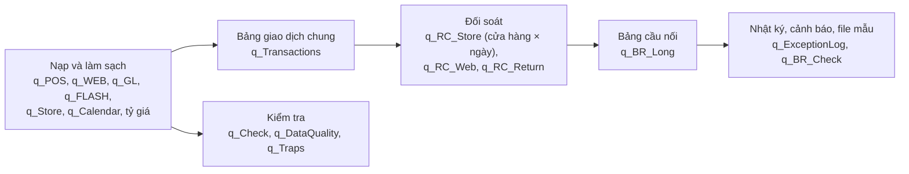

# File Power Query

> Phần chính của bài: nạp 4 file dữ liệu, làm sạch, đối soát, lập bảng cầu nối và nhật ký ngoại lệ, tất cả bằng Power Query (công cụ nạp và xử lý dữ liệu có sẵn trong Excel).

## 1. Các file

| File | Là gì |
|---|---|
| `Nexa_Home_Recon_PQ.xlsx` | File Excel đã dựng sẵn, có 30 sheet. Sheet `Huong_dan` liệt kê từng sheet |
| `queries/*.m` | Code của 31 truy vấn, mỗi truy vấn một file. **Đây là bản gốc**: bước nào cũng có tên tiếng Việt và ghi chú `//` |
| `queries/manifest.csv` | Danh sách truy vấn theo thứ tự nạp: tên truy vấn, sheet nạp ra (trống = chỉ tạo kết nối), tiêu đề sheet |
| `huong_dan.txt` | Nội dung sheet `Huong_dan` |
| `build_workbook.ps1` | Dựng lại file Excel từ đầu từ các file `.m` (khoảng 5 phút) |
| `refresh_workbook.ps1` | Làm mới file đã dựng (giống Data > Refresh All), có thể đổi thư mục dữ liệu |

## 2. Dùng file

1. Mở `Nexa_Home_Recon_PQ.xlsx`, sửa ô `Cai_dat!B2` thành thư mục chứa dữ liệu (thư mục `data/` của project).
2. Chọn Data > Refresh All, chờ khoảng 3–5 phút.
3. Xem sheet `Kiem_tra` (13 chỉ tiêu phải TRUE) và `Canh_bao_cau_noi` (dòng "Cần xem" là chỗ cần giải thích).

Tháng mới: thay 4 file dữ liệu (giữ phần đầu tên file, mỗi loại đúng 1 file) và thay file danh mục `Nexa_Home_Master_Data.xlsx` bằng bản có lịch, tỷ giá của tháng mới, rồi làm mới. Không sửa truy vấn nào. Đã chạy thử với tháng 01/2026 giả (xem `checks/README.md`).

## 3. Đọc code theo thứ tự nào



1. `q_POS`, `q_WEB`, `q_GL`, `q_FLASH`: nạp 4 file, xử lý 5 bẫy khi nạp (sheet `Bay_du_lieu` có số trước và sau khi xử lý).
2. `q_Transactions`: gộp POS (Point of Sale, bán tại cửa hàng) và online thành một bảng, ghép mã cửa hàng, đổi ra USD (đô la Mỹ) theo tỷ giá ngày và tỷ giá cuối tháng.
3. `q_RC_*`: đối soát với sổ cái theo cửa hàng × ngày ghi sổ, online × ngày giao, hàng trả × ngày trả.
4. `q_BR_Long`: bảng cầu nối dạng dài (bảng × tháng × khoản). Mọi khoản tính thẳng từ dữ liệu; dòng kiểm tra phải bằng 0.
5. `q_ExceptionLog`: nhật ký ngoại lệ. Bốn sheet `Cau_noi`, `Cau_noi_cua_hang`, `Cau_noi_online`, `Nhat_ky_ngoai_le` chép từ file mẫu của đề, đọc số bằng hàm Excel (SUMIFS, INDEX), không ô nào gõ tay. Sheet `Cau_noi_toan_cong_ty` thì khác: do truy vấn `q_BR_Company` nạp ra.

Mỗi truy vấn làm gì: xem dòng ghi chú đầu tiên của file `.m`, hoặc phụ lục A của báo cáo.

## 4. Sửa truy vấn

Sửa file `.m` trong `queries/` (không sửa trong Excel rồi bỏ đó), rồi dựng lại:

```
powershell -ExecutionPolicy Bypass -File excel\build_workbook.ps1
```

Thêm truy vấn mới: thêm file `.m` và một dòng vào `queries/manifest.csv`.
