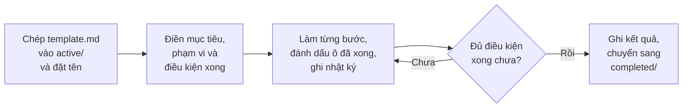

# Các plan của dự án

> Tài liệu đi kèm [roadmap](../roadmap.md). Từ khó xem ở [từ điển](../tu_dien_roadmap.md).

---

## 1. Plan là gì

- Roadmap (kế hoạch làm việc) chia bài thành 8 việc lớn. Mỗi việc lớn quá nặng để làm một lần, nên được chia nhỏ thành nhiều **plan**.
- Mỗi plan là **một phần việc có kết quả kiểm tra được**, làm trong khoảng nửa ngày đến 2 ngày. Nếu dài hơn thì tách thành 2 plan.
- File plan là **nơi ghi lại toàn bộ những gì đã làm**:
  - Trước khi làm: mục tiêu, phạm vi, con số phải khớp.
  - Trong khi làm: các bước, nhật ký từng buổi, các quyết định.
  - Khi xong: kết quả, việc còn lại, phần đã dùng AI (trí tuệ nhân tạo).
- Nhờ vậy, ai trong nhóm mở plan ra cũng biết phần đó làm thế nào, số lấy ở đâu, và tự giải thích lại được khi vấn đáp.

**Nhánh (branch) `baseline`:** trên nhánh này, nhóm đi qua toàn bộ roadmap một lượt để nắm bức tranh toàn cảnh và quy trình làm việc. Các plan của lượt này nằm trên nhánh `baseline`.

---

## 2. Thư mục

| Đường dẫn | Chứa gì |
|---|---|
| `plans/README.md` | File này: cách dùng và danh sách plan |
| `plans/template.md` | File mẫu (template), chép ra khi tạo plan mới |
| `plans/active/` | Plan đang làm |
| `plans/completed/` | Plan đã đóng (đã xong hoặc đã hủy) |

---

## 3. Đặt tên file plan

**Mẫu tên:** `<tên người làm>-<ngày tạo>-<việc>.md`

| Phần | Cách viết | Ví dụ |
|---|---|---|
| Tên người làm | <ul><li>Tên gọi (từ cuối của họ tên) viết đủ, rồi thêm chữ cái đầu của từng từ còn lại theo thứ tự</li><li>Bỏ dấu, viết chữ thường, "đ" viết thành "d"</li></ul> | <ul><li>Lê Nguyễn Phước Thành → `thanhlnp`</li><li>Trần Thị Mai → `maitt`</li><li>Đặng Văn Đức → `ducdv`</li></ul> |
| Ngày tạo | <ul><li>Ngày bắt đầu plan, dạng `dd-mm-yyyy`</li><li>Giữ nguyên khi plan xong, không đổi thành ngày xong</li></ul> | `18-10-2026` |
| Việc | <ul><li>2–4 từ nói plan làm gì</li><li>Chữ thường, không dấu, nối bằng dấu gạch ngang</li><li>Ưu tiên tiếng Anh ngắn gọn</li></ul> | `create-history`, `load-clean-data` |

**Ví dụ tên đầy đủ:** `thanhlnp-18-10-2026-create-history.md`

---

## 4. Một plan đi qua các bước nào

1. **Tạo plan:** chép `template.md` vào `active/`, đặt tên theo mục 3.
2. **Trước khi làm:** điền mục tiêu, phạm vi, đầu vào, đầu ra và **điều kiện xong** (con số nào phải khớp, lấy số đúng ở đâu). Thống nhất phần này rồi mới bắt tay vào làm.
3. **Trong khi làm:**
   - Đánh dấu `[x]` vào bước đã xong.
   - Cuối mỗi buổi ghi một dòng vào nhật ký.
   - Không xóa dòng nhật ký cũ. Nếu ghi sai thì thêm dòng mới để sửa lại.
4. **Khi đủ điều kiện xong:**
   - Điền phần kết quả.
   - Chuyển file sang `completed/` bằng lệnh `git mv` (cách chuyển này giữ được lịch sử sửa file).
   - Cập nhật bảng ở mục 6.
5. **Nếu tạm dừng:** để file ở `active/`, ghi trạng thái "Tạm dừng" kèm lý do.
6. **Nếu hủy:** chuyển sang `completed/`, ghi trạng thái "Hủy" kèm lý do. Việc nào chuyển sang plan khác thì ghi tên plan đó.

---

## 5. Quy tắc chung

- **Mỗi plan ghi rõ thuộc việc nào và mốc nào trong roadmap.**
- **Không chép lại quy ước tính vào plan.**
  - Chỉ dẫn link tới [quy ước tính và số chuẩn](../docs/quy_uoc_va_so_chuan.md) và ghi điều nào áp dụng.
  - Nếu trong lúc làm phải đổi quy ước: sửa file quy ước, ghi lý do và ngày đổi, rồi ghi lại quyết định đó vào plan.
- **Mọi con số ghi trong plan đều kèm nơi lấy số** (file, sheet hoặc truy vấn), giống nguyên tắc của roadmap.
- **Ghi lại phần dùng AI ở mục "Dùng AI" của plan.** Khi viết báo cáo, nhóm gom các mục này thành phụ lục khai báo dùng AI.
- **Ghi lại phần báo cáo liên quan.** Báo cáo được viết dần, nên mỗi plan ghi rõ kết quả của mình sẽ đưa vào phần nào trong 8 phần của báo cáo (slide 45).
- **Lưu vào Git (phần mềm lưu lịch sử sửa file) bằng lệnh commit sau mỗi đầu việc nhỏ.** Lời nhắn khi lưu bắt đầu bằng tên việc của plan, ví dụ `load-clean-data: ...`. Việc đẩy lên GitHub (trang web lưu file chung của nhóm, lệnh push) do người dùng tự quyết.

---

## 6. Danh sách plan

Cập nhật bảng này mỗi khi tạo, xong hoặc hủy một plan.

| Plan | Thuộc việc trong roadmap | Người làm | Trạng thái | Ngày xong |
|---|---|---|---|---|
| [Plan tổng](active/thanhlnp-18-10-2026-master-plan.md) | Cả 8 việc | thanhlnp | Đang làm | |
| [setup-baseline](completed/thanhlnp-18-10-2026-setup-baseline.md) | Việc 1 – Hiểu đề và chốt quy ước tính | thanhlnp | Xong | 18/10/2026 |
