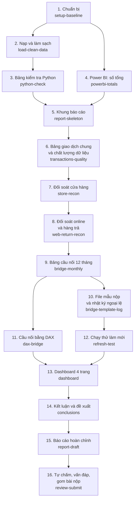

# Plan tổng: đi hết roadmap trên nhánh baseline

## Thông tin chung

| Mục | Nội dung |
|---|---|
| Người làm | Lê Nguyễn Phước Thành (thanhlnp), làm cùng AI (trí tuệ nhân tạo) Claude |
| Ngày bắt đầu | 18/10/2026 |
| Ngày xong | |
| Nhánh (branch) | `baseline` |
| Thuộc việc nào trong roadmap | Cả 8 việc của [roadmap](../../roadmap.md) |
| Trạng thái | Đang làm |

---

## 1. Mục tiêu

- Làm **bản thật, đủ chất lượng để nộp**, đi qua cả 8 việc của roadmap.
- Qua đó cả nhóm nắm được bức tranh toàn cảnh và quy trình làm bài: nạp dữ liệu → đối soát → bảng cầu nối → kiểm tra bằng cách tính thứ hai → dashboard → kết luận → báo cáo.
- Tập trung vào **ý tưởng và phân tích**. Không làm thêm những thứ đề không cần (CI – tự động chạy kiểm tra trên GitHub, nhiều công cụ kiểm tra phụ).

---

## 2. Cách làm

- Chia roadmap thành **16 plan nhỏ**. Mỗi plan có file riêng theo [file mẫu](../template.md).
- **Làm xong plan này mới tạo plan tiếp theo.**
- Mỗi plan đi qua các bước:
  1. Tạo file plan trong `plans/active/`, điền mục tiêu, phạm vi, điều kiện xong, các bước trước khi làm.
  2. Làm từng bước. Lưu lên GitHub (commit) theo từng đầu việc nhỏ. **Không đẩy lên GitHub (push).**
  3. Ghi nhật ký, quyết định, phần dùng AI, chuẩn bị vấn đáp.
  4. Một trợ lý AI khác (subagent) rà soát: kiểm tra lại số, quy ước, cách viết; sửa lỗi nhỏ. Không chạy Excel hay Power BI trong lúc rà soát.
  5. Xem lại phần đã sửa, lưu, chuyển file plan sang `plans/completed/`, cập nhật bảng trạng thái ở mục 5.
- Việc cần người dùng tự quyết thì ghi vào [backlog](../backlog.md) và đi tiếp với phương án an toàn, không dừng lại hỏi.

---

## 3. Thứ tự 16 plan

- Mũi tên: phải xong plan trước mới làm được plan sau.
- Plan 11 (DAX) làm sau plan 9 để có số Power Query mà so, dù roadmap cho phép làm song song.

---

## 4. Tóm tắt từng plan

| # | Plan | Thuộc việc | Làm gì | Xong khi |
|---|---|---|---|---|
| 1 | `setup-baseline` | Việc 1 | <ul><li>Tạo thư mục làm việc</li><li>Lưu bảng số chuẩn `checks/numbers_of_record.csv`</li><li>Viết bản mô tả cấu trúc dữ liệu và danh mục khoản cầu nối</li><li>Cài Power BI</li><li>Chạy thử nhanh Excel tự động và Power BI tự động</li><li>Lập câu hỏi xin mentor</li></ul> | <ul><li>Có đủ số chuẩn</li><li>Biết cách dựng Excel và Power BI nào chạy được</li></ul> |
| 2 | `load-clean-data` | Việc 2 | <ul><li>File Excel Power Query: ô đường dẫn thư mục, 8 truy vấn nạp</li><li>Xử lý 5 bẫy, mỗi bẫy có ví dụ trước/sau</li><li>Sheet kiểm tra tổng; chênh lệch năm/tháng/kênh</li></ul> | <ul><li>Khớp 13 chỉ tiêu của bảng tổng kiểm soát</li><li>Khớp 12 tháng, 3 kênh</li></ul> |
| 3 | `python-check` | Việc 4 (phần kiểm tra nội bộ) | Tính lại từng khoản cầu nối theo tháng và kênh bằng Python, chỉ để đối chiếu | <ul><li>Khớp số chuẩn cả năm, tháng 11, tháng 12</li><li>Chốt cách tính làm tròn</li></ul> |
| 4 | `powerbi-totals` | Việc 5 (phần đầu) | Dự án Power BI: nạp dữ liệu của mentor, nối bảng, công thức Flash, sổ cái, chênh lệch | Ra đúng số tổng cả năm và 12 tháng |
| 5 | `report-skeleton` | Việc 8 (phần đầu) | Khung báo cáo 8 phần, phần I có câu hỏi của Giám đốc Tài chính và câu hỏi riêng của nhóm | Chuyển ra PDF được |
| 6 | `transactions-quality` | Việc 2 (phần sau) | Bảng giao dịch chung (gộp cửa hàng và online), sheet chất lượng dữ liệu | Tổng theo tháng khớp bảng kiểm tra Python |
| 7 | `store-recon` | Việc 3 | Đối soát cửa hàng theo ngày ghi sổ, cờ ⚠ vượt ngưỡng, chứng minh lệch thời điểm tự bù trừ | 5.120 ô: 5.118 khớp, 2 lệch |
| 8 | `web-return-recon` | Việc 3 | Đối soát online, hàng trả, đơn hủy; chứng minh 5 lý do lệch bằng số; xếp 4 nhóm | 1.647 ô online và 159 ô hàng trả khớp 100% |
| 9 | `bridge-monthly` | Việc 4 | Bảng cầu nối 12 tháng theo kênh và toàn công ty, có dòng kiểm tra và cảnh báo | Khớp bảng kiểm tra Python từng tháng, từng khoản |
| 10 | `bridge-template-log` | Việc 4 | Điền file mẫu nộp bằng công thức lấy từ Power Query; nhật ký ngoại lệ | Dòng kiểm tra = 0, không ô nào gõ tay |
| 11 | `dax-bridge` | Việc 5 | Tính lại từng khoản cầu nối bằng DAX (Data Analysis Expressions, ngôn ngữ công thức của Power BI) | DAX và Power Query ra cùng số |
| 12 | `refresh-test` | Việc 2 | Chạy thử làm mới ở thư mục khác, với dữ liệu giả của một tháng mới và một cửa hàng mới | Không phải sửa truy vấn nào |
| 13 | `dashboard` | Việc 6 | Dashboard 4 trang | Đủ [yêu cầu dashboard](../../docs/yeu_cau_dashboard.md) |
| 14 | `conclusions` | Việc 7 | Kết luận, đề xuất xếp ưu tiên, rủi ro, giả thuyết đã bác bỏ | Mỗi kết luận có nguồn số |
| 15 | `report-draft` | Việc 8 | Báo cáo hoàn chỉnh 8 phần và phụ lục | PDF đủ, không còn chỗ trống |
| 16 | `review-submit` | Việc 8 | Tự chấm theo rubric, tập vấn đáp, chạy lại toàn bộ, gom bài nộp | Mọi kiểm tra cuối đạt |

Mỗi plan từ số 2 trở đi có bước cuối là viết phần báo cáo liên quan.

---

## 5. Trạng thái

| # | Plan | Trạng thái | File plan |
|---|---|---|---|
| 1 | `setup-baseline` | Chưa làm | |
| 2 | `load-clean-data` | Chưa làm | |
| 3 | `python-check` | Chưa làm | |
| 4 | `powerbi-totals` | Chưa làm | |
| 5 | `report-skeleton` | Chưa làm | |
| 6 | `transactions-quality` | Chưa làm | |
| 7 | `store-recon` | Chưa làm | |
| 8 | `web-return-recon` | Chưa làm | |
| 9 | `bridge-monthly` | Chưa làm | |
| 10 | `bridge-template-log` | Chưa làm | |
| 11 | `dax-bridge` | Chưa làm | |
| 12 | `refresh-test` | Chưa làm | |
| 13 | `dashboard` | Chưa làm | |
| 14 | `conclusions` | Chưa làm | |
| 15 | `report-draft` | Chưa làm | |
| 16 | `review-submit` | Chưa làm | |

---

## 6. Những thứ dùng chung cho mọi plan

**Thư mục:**

| Thư mục | Chứa gì |
|---|---|
| `data/` | 4 file dữ liệu gốc, file danh mục, file mẫu nộp gốc. **Không sửa.** |
| `excel/` | File Excel Power Query, các file `.m` (file code của Power Query), script dựng file |
| `checks/` | Bảng số chuẩn, script Python kiểm tra, kết quả đối chiếu |
| `powerbi/` | Dự án Power BI, file công thức DAX |
| `report/` | Báo cáo LaTeX và hình |
| `submission/` | Bộ file nộp, tạo ở plan cuối |

**Quy ước tính:** theo [quy ước tính và số chuẩn](../../docs/quy_uoc_va_so_chuan.md). Chỗ nào plan nhỏ phải đổi quy ước thì sửa file đó, ghi lý do và ngày.

**Danh mục khoản cầu nối và bảng cầu nối dạng dài:** định nghĩa ở plan 1, ghi trong file mô tả cấu trúc dữ liệu. Mọi phần (Power Query, Python, DAX, file mẫu nộp, dashboard, hình trong báo cáo) đều dùng chung một danh mục và một dạng bảng, để so được với nhau.

---

## 7. Nhật ký làm việc

| Ngày | Đã làm | Kết quả | Vướng mắc, cách xử lý |
|---|---|---|---|
| 18/10 | <ul><li>Đọc roadmap, slide, rubric, file mẫu</li><li>Kiểm tra dữ liệu gốc</li><li>Lập plan tổng</li></ul> | <ul><li>13 chỉ tiêu tổng kiểm soát khớp</li><li>Chênh lệch 12 tháng và 3 kênh khớp slide</li><li>Bản nháp cầu nối cả năm khớp số chuẩn</li></ul> | Số làm tròn có 3 phiên bản khác nhau (slide 1,01; tài liệu nhóm 0,96; dashboard mẫu 2,33). Để plan 3 chốt |

---

## 8. Dùng AI (trí tuệ nhân tạo)

| Ngày | Nhờ AI làm gì | Phần nào do AI viết ra | Nhóm tự kiểm tra lại bằng cách nào |
|---|---|---|---|
| 18/10 | Đọc tài liệu, kiểm tra dữ liệu, lập plan | Toàn bộ file plan này | Đối chiếu các con số với bảng tổng kiểm soát QC_Summary và slide |

---

## 9. Kết quả khi đóng plan tổng

- **Điều kiện xong:**
- **Việc còn lại:**
- **Các lần lưu lên GitHub:**
