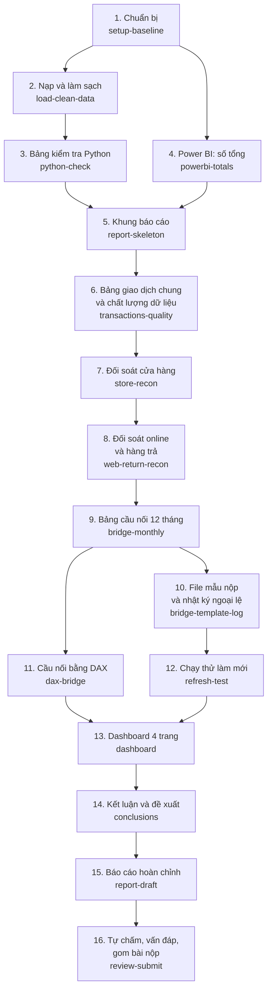

# Plan tổng: đi hết roadmap trên nhánh baseline

## Thông tin chung

| Mục | Nội dung |
|---|---|
| Người làm | Lê Nguyễn Phước Thành (thanhlnp), làm cùng AI (trí tuệ nhân tạo) Claude |
| Ngày bắt đầu | 18/10/2026 |
| Ngày xong | |
| Nhánh (branch) | `baseline` |
| Thuộc việc nào trong roadmap | Cả 8 việc của [roadmap](../../roadmap.md) |
| Trạng thái | Đang làm |

---

## 1. Mục tiêu

- Làm **bản thật, đủ chất lượng để nộp**, đi qua cả 8 việc của roadmap.
- Qua đó cả nhóm nắm được bức tranh toàn cảnh và quy trình làm bài: nạp dữ liệu → đối soát → bảng cầu nối → kiểm tra bằng cách tính thứ hai → dashboard → kết luận → báo cáo.
- Tập trung vào **ý tưởng và phân tích**. Không làm thêm những thứ đề không cần (CI – tự động chạy kiểm tra trên GitHub, nhiều công cụ kiểm tra phụ).

---

## 2. Cách làm

- Chia roadmap thành **16 plan nhỏ**. Mỗi plan có file riêng theo [file mẫu](../template.md).
- **Làm xong plan này mới tạo plan tiếp theo.**
- Mỗi plan đi qua các bước:
  1. Tạo file plan trong `plans/active/`, điền mục tiêu, phạm vi, điều kiện xong, các bước trước khi làm.
  2. Làm từng bước. Lưu vào Git (commit) theo từng đầu việc nhỏ. **Không đẩy lên GitHub (push).**
  3. Ghi nhật ký, quyết định, phần dùng AI, chuẩn bị vấn đáp.
  4. Một trợ lý AI khác (subagent) rà soát: kiểm tra lại số, quy ước, cách viết; sửa lỗi nhỏ. Không chạy Excel hay Power BI trong lúc rà soát.
  5. Xem lại phần đã sửa, lưu, chuyển file plan sang `plans/completed/`, cập nhật bảng trạng thái ở mục 5.
- Việc cần người dùng tự quyết thì ghi vào [backlog](../backlog.md) và đi tiếp với phương án an toàn, không dừng lại hỏi.

---

## 3. Thứ tự 16 plan

- Mũi tên: phải xong plan trước mới làm được plan sau.
- Plan 11 (DAX) làm sau plan 9 để có số Power Query mà so, dù roadmap cho phép làm song song.

---

## 4. Tóm tắt từng plan

| # | Plan | Thuộc việc | Làm gì | Xong khi |
|---|---|---|---|---|
| 1 | `setup-baseline` | Việc 1 | <ul><li>Tạo thư mục làm việc</li><li>Lưu bảng số chuẩn `checks/numbers_of_record.csv`</li><li>Viết bản mô tả cấu trúc dữ liệu và danh mục khoản cầu nối</li><li>Cài Power BI</li><li>Chạy thử nhanh Excel tự động và Power BI tự động</li><li>Lập câu hỏi xin mentor</li></ul> | <ul><li>Có đủ số chuẩn</li><li>Biết cách dựng Excel và Power BI nào chạy được</li></ul> |
| 2 | `load-clean-data` | Việc 2 | <ul><li>File Excel Power Query: ô đường dẫn thư mục, 8 truy vấn nạp</li><li>Xử lý 5 bẫy, mỗi bẫy có ví dụ trước/sau</li><li>Sheet kiểm tra tổng; chênh lệch năm/tháng/kênh</li></ul> | <ul><li>Khớp 13 chỉ tiêu của bảng tổng kiểm soát</li><li>Khớp 12 tháng, 3 kênh</li></ul> |
| 3 | `python-check` | Việc 4 (phần kiểm tra nội bộ) | Tính lại từng khoản cầu nối theo tháng và kênh bằng Python, chỉ để đối chiếu | <ul><li>Khớp số chuẩn cả năm, tháng 11, tháng 12</li><li>Chốt cách tính làm tròn</li></ul> |
| 4 | `powerbi-totals` | Việc 5 (phần đầu) | Dự án Power BI: nạp dữ liệu của mentor, nối bảng, công thức Flash, sổ cái, chênh lệch | Ra đúng số tổng cả năm và 12 tháng |
| 5 | `report-skeleton` | Việc 8 (phần đầu) | Khung báo cáo 8 phần, phần I có câu hỏi của Giám đốc Tài chính và câu hỏi riêng của nhóm | Chuyển ra PDF được |
| 6 | `transactions-quality` | Việc 2 (phần sau) | Bảng giao dịch chung (gộp cửa hàng và online), sheet chất lượng dữ liệu | Tổng theo tháng khớp bảng kiểm tra Python |
| 7 | `store-recon` | Việc 3 | Đối soát cửa hàng theo ngày ghi sổ, cờ ⚠ vượt ngưỡng, chứng minh lệch thời điểm tự bù trừ | 5.120 ô: 5.118 khớp, 2 lệch |
| 8 | `web-return-recon` | Việc 3 | Đối soát online, hàng trả, đơn hủy; chứng minh 5 lý do lệch bằng số; xếp 4 nhóm | 1.647 ô online và 159 ô hàng trả khớp 100% |
| 9 | `bridge-monthly` | Việc 4 | Bảng cầu nối 12 tháng theo kênh và toàn công ty, có dòng kiểm tra và cảnh báo | Khớp bảng kiểm tra Python từng tháng, từng khoản |
| 10 | `bridge-template-log` | Việc 4 | Điền file mẫu nộp bằng công thức lấy từ Power Query; nhật ký ngoại lệ | Dòng kiểm tra = 0, không ô nào gõ tay |
| 11 | `dax-bridge` | Việc 5 | Tính lại từng khoản cầu nối bằng DAX (Data Analysis Expressions, ngôn ngữ công thức của Power BI) | DAX và Power Query ra cùng số |
| 12 | `refresh-test` | Việc 2 | Chạy thử làm mới ở thư mục khác, với dữ liệu giả của một tháng mới và một cửa hàng mới | Không phải sửa truy vấn nào |
| 13 | `dashboard` | Việc 6 | Dashboard 4 trang | Đủ [yêu cầu dashboard](../../docs/yeu_cau_dashboard.md) |
| 14 | `conclusions` | Việc 7 | Kết luận, đề xuất xếp ưu tiên, rủi ro, giả thuyết đã bác bỏ | Mỗi kết luận có nguồn số |
| 15 | `report-draft` | Việc 8 | Báo cáo hoàn chỉnh 8 phần và phụ lục | PDF đủ, không còn chỗ trống |
| 16 | `review-submit` | Việc 8 | Tự chấm theo rubric, tập vấn đáp, chạy lại toàn bộ, gom bài nộp | Mọi kiểm tra cuối đạt |

Mỗi plan từ số 2 trở đi có bước cuối là viết phần báo cáo liên quan.

---

## 5. Trạng thái

| # | Plan | Trạng thái | File plan |
|---|---|---|---|
| 1 | `setup-baseline` | Xong 18/10 | [thanhlnp-18-10-2026-setup-baseline.md](../completed/thanhlnp-18-10-2026-setup-baseline.md) |
| 2 | `load-clean-data` | Xong 18/10 | [thanhlnp-18-10-2026-load-clean-data.md](../completed/thanhlnp-18-10-2026-load-clean-data.md) |
| 3 | `python-check` | Xong 18/10 | [thanhlnp-18-10-2026-python-check.md](../completed/thanhlnp-18-10-2026-python-check.md) |
| 4 | `powerbi-totals` | Xong 18/10 | [thanhlnp-18-10-2026-powerbi-totals.md](../completed/thanhlnp-18-10-2026-powerbi-totals.md) |
| 5 | `report-skeleton` | Xong 18/10 | [thanhlnp-18-10-2026-report-skeleton.md](../completed/thanhlnp-18-10-2026-report-skeleton.md) |
| 6 | `transactions-quality` | Xong 18/10 | [thanhlnp-18-10-2026-transactions-quality.md](../completed/thanhlnp-18-10-2026-transactions-quality.md) |
| 7 | `store-recon` | Xong 18/10 | [thanhlnp-18-10-2026-store-recon.md](../completed/thanhlnp-18-10-2026-store-recon.md) |
| 8 | `web-return-recon` | Xong 18/10 | [thanhlnp-18-10-2026-web-return-recon.md](../completed/thanhlnp-18-10-2026-web-return-recon.md) |
| 9 | `bridge-monthly` | Xong 18/10 | [thanhlnp-18-10-2026-bridge-monthly.md](../completed/thanhlnp-18-10-2026-bridge-monthly.md) |
| 10 | `bridge-template-log` | Xong 18/10 | [thanhlnp-18-10-2026-bridge-template-log.md](../completed/thanhlnp-18-10-2026-bridge-template-log.md) |
| 11 | `dax-bridge` | Xong 18/10 | [thanhlnp-18-10-2026-dax-bridge.md](../completed/thanhlnp-18-10-2026-dax-bridge.md) |
| 12 | `refresh-test` | Xong 18/10 | [thanhlnp-18-10-2026-refresh-test.md](../completed/thanhlnp-18-10-2026-refresh-test.md) |
| 13 | `dashboard` | Xong 18/10 | [thanhlnp-18-10-2026-dashboard.md](../completed/thanhlnp-18-10-2026-dashboard.md) |
| 14 | `conclusions` | Xong 18/10 | [thanhlnp-18-10-2026-conclusions.md](../completed/thanhlnp-18-10-2026-conclusions.md) |
| 15 | `report-draft` | Xong 18/10 | [thanhlnp-18-10-2026-report-draft.md](../completed/thanhlnp-18-10-2026-report-draft.md) |
| 16 | `review-submit` | Chưa làm | |

---

## 6. Những thứ dùng chung cho mọi plan

**Thư mục:**

| Thư mục | Chứa gì |
|---|---|
| `data/` | 4 file dữ liệu gốc, file danh mục, file mẫu nộp gốc. **Không sửa.** |
| `excel/` | File Excel Power Query, các file `.m` (file code của Power Query), script dựng file |
| `checks/` | Bảng số chuẩn, script Python kiểm tra, kết quả đối chiếu |
| `powerbi/` | Dự án Power BI, file công thức DAX |
| `report/` | Báo cáo LaTeX và hình |
| `submission/` | Bộ file nộp, tạo ở plan cuối |

**Quy ước tính:** theo [quy ước tính và số chuẩn](../../docs/quy_uoc_va_so_chuan.md). Chỗ nào plan nhỏ phải đổi quy ước thì sửa file đó, ghi lý do và ngày.

**Danh mục khoản cầu nối và bảng cầu nối dạng dài:** định nghĩa ở plan 1, ghi trong file mô tả cấu trúc dữ liệu. Mọi phần (Power Query, Python, DAX, file mẫu nộp, dashboard, hình trong báo cáo) đều dùng chung một danh mục và một dạng bảng, để so được với nhau.

---

## 7. Nhật ký làm việc

| Ngày | Đã làm | Kết quả | Vướng mắc, cách xử lý |
|---|---|---|---|
| 18/10 | <ul><li>Đọc roadmap, slide, rubric, file mẫu</li><li>Kiểm tra dữ liệu gốc</li><li>Lập plan tổng</li></ul> | <ul><li>13 chỉ tiêu tổng kiểm soát khớp</li><li>Chênh lệch 12 tháng và 3 kênh khớp slide</li><li>Bản nháp cầu nối cả năm khớp số chuẩn</li></ul> | Số làm tròn có 3 phiên bản khác nhau (slide 1,01; tài liệu nhóm 0,96; dashboard mẫu 2,33). Đã chốt 1,01 khi rà soát plan 1 |
| 18/10 | Xong plan 1 `setup-baseline` | <ul><li>Có bảng số chuẩn và bản mô tả cấu trúc dữ liệu</li><li>Đã cài Power BI; chạy thử được Excel tự động và Power BI tự động</li><li>Sửa quy ước: tỷ giá −57.598,01, làm tròn +1,01 (theo slide 34)</li></ul> | Chi tiết ở file plan 1 |
| 18/10 | Xong plan 2 `load-clean-data` | <ul><li>File Excel Power Query dựng từ 14 file .m bằng script, mọi bước có ghi chú</li><li>13/13 chỉ tiêu QC_Summary khớp; chênh lệch 12 tháng, cả năm, 3 kênh khớp slide</li><li>Bảng 5 bẫy có số trước và sau khi xử lý</li></ul> | Lần dựng đầu bị quá giờ do bước tìm dòng trùng chậm; đã sửa, dựng mất khoảng 2 phút |
| 18/10 | Xong plan 3 `python-check` | <ul><li>Bảng cầu nối 4 bảng × 12 tháng × 15 khoản tính bằng Python, dùng làm đáp án nội bộ</li><li>Khớp số chuẩn cả năm, tháng 12 (slide 36), các cặp tháng; dòng kiểm tra 0; 0 dòng sai</li><li>Thêm cách tính tỷ giá thứ hai và kiểm tra từng ô online, vì dòng kiểm tra một mình không bắt được lỗi xếp nhầm tháng</li></ul> | Rà soát chỉ ra dòng kiểm tra luôn bằng 0 theo cách định nghĩa; đã thêm các phép kiểm tra độc lập |
| 18/10 | Xong plan 4 `powerbi-totals` | <ul><li>Dự án Power BI viết bằng file chữ: 12 bảng, 18 quan hệ theo slide 19, bảng ngày, 5 công thức</li><li>Hỏi số bằng DAX: cả năm, 12 tháng, 3 kênh khớp số chuẩn; trang "Số tổng" hiện đúng</li></ul> | Lần mở đầu Power BI báo lỗi "description" ở quan hệ; đã bỏ mô tả khỏi quan hệ |
| 18/10 | Xong plan 5 `report-skeleton` – **đủ các việc của Mốc 2** | <ul><li>Báo cáo LaTeX đủ khung 8 phần + phụ lục, ra PDF 14 trang</li><li>Phần I–III viết thật; bảng, hình, số trong lời văn sinh tự động từ file Excel Power Query</li><li>3 câu hỏi riêng của nhóm, đo được bằng số</li></ul> | Câu hỏi riêng số 1 đã thay sau rà soát (backlog mục 6) |
| 18/10 | Xong plan 6 `transactions-quality` | <ul><li>Bảng giao dịch chung 26.565 dòng, USD theo 2 tỷ giá, khớp bảng kiểm tra Python mọi tháng</li><li>Sheet chất lượng dữ liệu 13 phép; 4 "Cần xem" ứng với 3 lỗi đã biết</li></ul> | Thêm phép kiểm tra cho dữ liệu tháng mới sau rà soát |
| 18/10 | Plan 7 `store-recon`: đối soát cửa hàng × ngày ghi sổ, cờ vượt ngưỡng trước/sau, lệch ngày ghi sổ; phần IV.1 | <ul><li>5.120 ô: 5.118 khớp, 2 lệch (NX057 21/11 và 02/12, lỗi chuyển dữ liệu 7.227,56)</li><li>So theo ngày bán: 2.929 ô lệch (tháng 11: 347/453)</li><li>Cờ vượt ngưỡng: 137 lượt cửa hàng × tháng trước xử lý → 2 sau xử lý; tháng 11: 21 → 1</li><li>3 cặp tháng lệch ngày ghi sổ, cả năm 0</li><li>Tái lập được 22 cửa hàng (21 + online) và NX008 −716,19 của slide</li></ul> | Số −716,19 cần tỷ giá cuối tháng bán (không phải do làm tròn như ghi trước đó) |
| 18/10 | Plan 8 `web-return-recon`: đối soát online × ngày giao và hàng trả × ngày trả, online theo tháng, lệch thời điểm online, bảng 5 lý do, danh mục khoản 4 nhóm; phần IV.2–IV.3 | <ul><li>Online 1.647/1.647 ô khớp, hàng trả 159/159</li><li>Online tháng 11: −12.064,26 → −0,01; 12/12 tháng vượt ngưỡng trước xử lý → 0 sau</li><li>Lệch thời điểm online −52.597,90 = +122.107,89 − 174.705,79; tháng 3 +281.787,98</li><li>5 lý do có số; danh mục khoản `q_BridgeItems` cho các plan sau</li></ul> | Mỗi lần dựng file Excel mất khoảng 15 phút; sửa 2 dòng ghi chú CSV bị dấu phẩy làm lệch cột |
| 18/10 | Plan 9 `bridge-monthly`: `q_BR_Long` 4 bảng × 12 tháng, cảnh báo tự động, bảng toàn công ty dạng ngang; phần IV.4, phụ lục D | <ul><li>708 dòng, khớp bảng kiểm tra Python (lệch ≤ 0,00005)</li><li>Cả năm và tháng 12 khớp 13/13 khoản số chuẩn</li><li>Dòng kiểm tra 0,00 ở 48/48 bảng × tháng; 2 cảnh báo tháng 9 (ADJ-0925)</li><li>Câu hỏi riêng 2: 4 tháng còn lệch quá 200 USD (tháng 3, 9, 11, 12)</li></ul> | Dòng kiểm tra không bắt được lỗi ở số gốc dùng chung (ví dụ tỷ giá ngày); bù bằng so với Python và DAX |
| 18/10 | Plan 10 `bridge-template-log`: sheet `Cau_noi` (và bản cửa hàng, online) điền bằng SUMIFS đọc `q_BR_Long`; `q_ExceptionLog` nạp vào `Nhat_ky_ngoai_le` bằng INDEX; `q_OrderSwap`; đoạn cuối IV.4, phụ lục B, E | <ul><li>Dòng kiểm tra 3 sheet cầu nối = 0 ở 12 tháng và cả năm; không ô số nào gõ tay</li><li>Nhật ký 18 dòng, tổng −2.425.904,77; trạng thái 14 / 2 / 1 / 1</li><li>Đổi thứ tự: dòng trùng −13.695,13; hàng trả tính sau tỷ giá −349.066,20</li></ul> | Dựng file từ đầu mất khoảng 55 phút (backlog mục 8); rà soát phát hiện cách đổi thứ 3 sai nghĩa và thiếu dòng rủi ro hàng trả sau kỳ, đã sửa |
| 18/10 | Plan 11 `dax-bridge`: cột tính, bảng `dim_bridge_item` và `pq_br_long` (tham số `PQFile`), 32 công thức DAX (từng khoản cầu nối, so với Power Query, mẫu slide 30 cửa hàng × tháng), `dax_measures.dax`; phần IV.5 | <ul><li>709 ô cầu nối, lệch DAX − Power Query lớn nhất 0,000000007 USD</li><li>Cửa hàng × tháng: 679/679 ô khớp; 137 → 2 ô vượt ngưỡng, tháng 11: 21 → 1</li></ul> | Khớp ngay lần đầu; rà soát đổi cách đếm ô vượt ngưỡng theo mã sổ cái cho giống Power Query |
| 18/10 | Plan 12 `refresh-test`: dữ liệu giả tháng 01/2026 + cửa hàng NX068 ở thư mục khác, `refresh_workbook.ps1`, `check_refresh.py`; dựng file nhanh hơn (bỏ qua mức riêng tư); mục II.8 | <ul><li>11/11 phép so đạt, không sửa truy vấn nào</li><li>Kỳ đối soát tự thành 13 tháng; 12 tháng 2025 giữ nguyên</li><li>Làm mới khoảng 3 phút; dựng từ đầu từ 55 phút còn khoảng 5 phút</li></ul> | Chưa thử trên máy thật thứ hai (backlog mục 2); Power BI không có dữ liệu tháng mới để thử |
| 18/10 | Plan 13 `dashboard`: 75 công thức thư mục "5. Dashboard", bảng `pq_data_quality`, `build_report.py` sinh 4 trang (80 hình), ảnh chụp 4 trang; mục IV.6, phụ lục F | <ul><li>Số trên dashboard khớp số chuẩn và Power Query (tháng 12, 4 nhóm cả năm, 5.120 ô, 2.929 ô lệch theo ngày bán, 12 / 124 / 15)</li><li>Câu "Điểm chính" và tiêu đề có số tự đổi theo bộ lọc; đúng ở 9 trường hợp biên</li></ul> | Chưa làm nút Đặt lại và tô tháng đang chọn (backlog mục 10); cột cuối thác nước ghi "Total" (backlog mục 11) |
| 18/10 | Plan 14 `conclusions`: phần V (trả lời 3 + 3 câu hỏi, 4 giả thuyết bị bác bỏ), VI (6 đề xuất xếp ưu tiên, danh sách việc theo tuần chốt sổ, 2 cách xử lý tỷ giá), VII (giới hạn, rủi ro, bước tiếp theo), hộp tóm tắt | <ul><li>99,5% chênh lệch là quy tắc ghi nhận; lỗi thật: 12 dòng POS trùng, NX057; ADJ-0925 chưa giải thích</li><li>Flash báo thêm doanh số thuần thì chênh lệch cả năm chỉ còn −0,09%</li></ul> | Rà soát sửa nhiều câu nói quá (ví dụ "21 cửa hàng chỉ vì so sai ngày" có cả NX057) |
| 18/10 | Plan 15 `report-draft`: phụ lục A (bảng 31 truy vấn, code 2 truy vấn chính), phụ lục khai báo AI (sinh tự động từ các plan); rà toàn bộ báo cáo | <ul><li>Báo cáo 45 trang, đủ 8 phần và 7 phụ lục (A–G)</li><li>Không còn chỗ giữ chỗ, không có tham chiếu trống; mọi bảng, hình được nhắc trong lời văn</li></ul> | Còn lặp ý giữa phần IV và V, tiêu đề mục chưa nói kết luận (backlog mục 12, 13) |

---

## 8. Dùng AI (trí tuệ nhân tạo)

| Ngày | Nhờ AI làm gì | Phần nào do AI viết ra | Nhóm tự kiểm tra lại bằng cách nào |
|---|---|---|---|
| 18/10 | Đọc tài liệu, kiểm tra dữ liệu, lập plan | Toàn bộ file plan này | Đối chiếu các con số với bảng tổng kiểm soát QC_Summary và slide |

---

## 9. Kết quả khi đóng plan tổng

- **Điều kiện xong:**
- **Việc còn lại:**
- **Các lần lưu vào Git (commit):**
