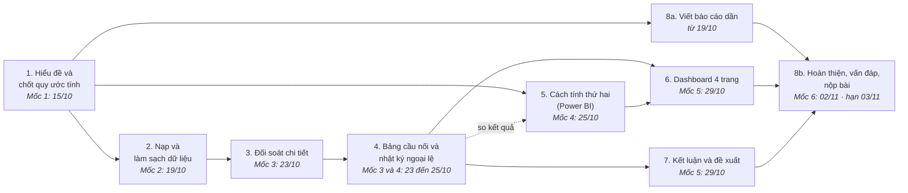

# KẾ HOẠCH LÀM VIỆC (ROADMAP) — Project 1: Đối soát doanh thu từ nhiều nguồn, Nexa Home 2025

---

## 1. Mục tiêu

- **Đây là bài đối soát**: so hai nguồn số để tìm chỗ lệch. **Không phải phân tích kinh doanh** (tăng trưởng, sản phẩm bán chạy, mùa vụ).
- Hai nguồn số:
  - **Flash**: báo cáo nhanh doanh số của phòng Kinh doanh.
  - **Sổ cái** (GL – General Ledger): sổ kế toán của phòng Tài chính. Nhóm lấy sổ cái làm nguồn chuẩn.
- Trả lời 3 câu hỏi của Giám đốc Tài chính:
  1. Lệch bao nhiêu, theo tháng và theo kênh bán?
  2. Lệch gồm những khoản nào, mỗi khoản bao nhiêu, khoản nào là lỗi?
  3. Quy trình cần đổi gì để tháng sau đối soát nhanh hơn?
- Bộ file phải nộp:
  - File Excel làm bằng Power Query (công cụ nạp và xử lý dữ liệu trong Excel).
  - File mẫu nộp `Mau_nop_Bang_cau_noi.xlsx` đã điền, gồm:
    - **Bảng cầu nối**: bảng đi từ số Flash xuống số sổ cái qua từng khoản lệch.
    - **Nhật ký ngoại lệ**: bảng ghi mỗi khoản lệch một dòng.
  - Dashboard 4 trang làm bằng Power BI (phần mềm của Microsoft để làm màn hình gồm các con số chính và biểu đồ).
  - Báo cáo PDF (Portable Document Format) viết bằng LaTeX (cách soạn tài liệu bằng file chữ rồi chuyển ra PDF), theo file mẫu báo cáo `docs/template/report_template/main.tex` (slide 45 gọi là "guide_report_template").

---

## 2. Các mốc

Bắt đầu: 14/10.

| Mốc | Ngày | Phải có |
|---|---|---|
| Mốc 1 | 15/10 | <ul><li>Đã chốt quy ước tính (các quy định chung về cách tính: lấy nguồn nào làm chuẩn, công thức chênh lệch, ngưỡng phải giải thích, thứ tự các khoản trong bảng cầu nối) và lưu lên GitHub (trang web lưu file và lịch sử sửa file)</li><li>Máy mọi người đã cài đủ phần mềm</li></ul> |
| Mốc 2 | **19/10** (buổi kiểm tra tiến độ) | <ul><li>Dữ liệu nạp vào khớp bảng tổng kiểm soát của đề (sheet QC_Summary: số dòng, tổng tiền chuẩn), xử lý đủ 5 bẫy (5 chỗ dễ nạp sai, xem Việc 2)</li><li>Chênh lệch theo năm, tháng, kênh khớp slide</li><li>Power BI ra đúng số tổng</li><li>Đã đặt 2–4 câu hỏi riêng của nhóm</li><li>Đã có khung báo cáo, chuyển ra PDF được</li></ul> |
| Mốc 3 | 23/10 | <ul><li>Đối soát chi tiết xong</li><li>Bảng cầu nối của tháng 3, tháng 11, tháng 12 khớp số chuẩn (con số đúng lấy từ slide, xem [quy ước tính và số chuẩn](docs/quy_uoc_va_so_chuan.md))</li></ul> |
| Mốc 4 | 25/10 | <ul><li>Bảng cầu nối đủ 12 tháng; dòng kiểm tra (Flash cộng các khoản rồi trừ sổ cái) về 0</li><li>Power Query và Power BI ra cùng một số</li><li>Chạy thử làm mới dữ liệu đạt: trên máy khác và với dữ liệu giả của một tháng mới</li><li>Nếu trễ Mốc 4 thì vẫn phải xong trước Mốc 5</li></ul> |
| Mốc 5 | 29/10 | <ul><li>Đủ mọi sản phẩm ở dạng bản nháp, kể cả báo cáo</li><li>Từ đây không thêm việc mới</li></ul> |
| Mốc 6 | 02/11, 20:00 | <ul><li>Nộp nội bộ (hạn nhóm tự đặt, sớm 1 ngày)</li><li>Đã tự chấm và tập vấn đáp</li></ul> |
| **Hạn nộp** | **03/11** | <ul><li>Nộp bài; cũng là ngày dự phòng</li></ul> |

---

## 3. Các đầu việc lớn

| Việc | Làm gì | Xong khi |
|---|---|---|
| **1. Hiểu đề và chốt quy ước tính** | <ul><li>Đọc slide và rubric (bảng tiêu chí chấm)</li><li>Chốt quy ước tính **trước khi nhìn số**: lấy nguồn nào làm chuẩn, cách tính chênh lệch, ngưỡng phải giải thích, thứ tự các bước của bảng cầu nối</li><li>Cài đủ phần mềm; lập danh sách câu hỏi xin mentor (người hướng dẫn) xác nhận</li><li>Nếu mentor trả lời khác quy ước đã chốt: lưu bản quy ước mới lên GitHub, ghi lý do và ngày đổi</li><li>Sau khi xem dữ liệu: đặt 2–4 câu hỏi riêng của nhóm, trả lời được bằng con số</li></ul> | Quy ước tính — Mốc 1; câu hỏi riêng — Mốc 2 |
| **2. Nạp và làm sạch dữ liệu** | <ul><li>Dùng Power Query nạp 4 file dữ liệu và 4 bảng danh mục (danh sách cửa hàng, lịch, 2 bảng tỷ giá). Mỗi truy vấn là một chuỗi bước xử lý cho ra một bảng</li><li>Mọi truy vấn đọc file qua tham số thư mục (1 ô chứa đường dẫn thư mục dữ liệu)</li><li>Xử lý 5 bẫy khi nạp (ngày kiểu Mỹ, dòng tiêu đề, số âm, dòng trùng, nhiều loại tiền)</li><li>Nối mã cửa hàng bên bán hàng với mã bên kế toán; gộp bán tại cửa hàng và đơn online thành một bảng giao dịch chung</li><li>Làm sheet kiểm tra: so với bảng tổng kiểm soát, đếm dòng trùng, ngày thiếu</li><li>Chạy thử làm mới dữ liệu trên máy khác và với dữ liệu giả của một tháng mới</li></ul> | Khớp bảng tổng kiểm soát — Mốc 2; chạy thử làm mới đạt — Mốc 4 |
| **3. Đối soát chi tiết** | <ul><li>Đối soát từ tổng xuống chi tiết, 3 mức:<ul><li>So tổng theo tháng</li><li>So theo kênh (tổng các kênh phải bằng tổng sổ cái)</li><li>So từng cửa hàng theo ngày ghi sổ (ngày kế toán ghi vào sổ); online và hàng trả theo ngày và loại tiền</li></ul></li><li>Chứng minh bằng số 5 lý do khiến hai nguồn lệch nhau</li><li>Đánh dấu chỗ lệch vượt ngưỡng; chứng minh phần lệch do thời điểm tự bù trừ ở tháng sau</li><li>Xếp mỗi khoản lệch vào 1 trong 4 nhóm: do cách tính khác nhau (quy tắc ghi nhận), lỗi dữ liệu, chưa giải thích được, sai số chấp nhận được</li></ul> | Mốc 3 |
| **4. Bảng cầu nối và nhật ký ngoại lệ** | <ul><li>Bảng cầu nối 12 tháng cho toàn công ty, cửa hàng và online; ghi rõ thứ tự các bước</li><li>Tách riêng dòng tỷ giá (phần lệch chỉ do dùng tỷ giá ngày hay tỷ giá cuối tháng)</li><li>Bảng theo kênh có dòng chuyển kênh (bút toán tay chuyển 3.480 USD từ cửa hàng sang online)</li><li>Nhật ký ngoại lệ: mỗi khoản lệch một dòng, ghi nhóm lệch và hướng xử lý</li><li>Điền file mẫu nộp bằng cách lấy số trực tiếp từ Power Query, không gõ tay</li></ul> | Dòng kiểm tra về 0, khớp số chuẩn — Mốc 3, Mốc 4 |
| **5. Kiểm tra lại bằng cách tính thứ hai** | <ul><li>Tính lại từng khoản của bảng cầu nối bằng công thức DAX (Data Analysis Expressions, ngôn ngữ công thức của Power BI), trên dữ liệu mentor đã chuẩn bị sẵn</li><li>So với kết quả Power Query; chỗ nào lệch thì tìm nguyên nhân, không ép cho khớp (nhét phần dư vào một khoản khác để dòng kiểm tra về 0)</li></ul> | Số tổng đúng — Mốc 2; hai cách tính ra cùng số — Mốc 4 |
| **6. Dashboard 4 trang** | <ul><li>Tổng quan · Cầu nối · Đối soát chi tiết · Hoàn trả, hủy và chất lượng dữ liệu</li><li>Bộ lọc dùng chung; tiêu đề biểu đồ nói luôn kết luận kèm con số</li></ul> | Đủ [yêu cầu dashboard](docs/yeu_cau_dashboard.md) — Mốc 5 |
| **7. Kết luận và đề xuất** | <ul><li>Kết luận theo 3 câu hỏi của Giám đốc Tài chính, nêu rõ giới hạn của kết luận</li><li>Đề xuất cải tiến quy trình: bộ phận nào của công ty làm, khi nào, theo dõi bằng chỉ số nào, xếp thứ tự ưu tiên</li><li>Nêu các rủi ro mà đề không nhắc tới, và các phỏng đoán đã kiểm tra nhưng thấy sai</li></ul> | Mốc 5 |
| **8. Báo cáo, vấn đáp và nộp bài** | <ul><li>Viết báo cáo 8 phần theo slide 45, **viết dần từ Mốc 2**, theo mạch Câu hỏi → Bằng chứng → Kết luận</li><li>Đọc soát chéo, tự chấm theo rubric, tập vấn đáp</li><li>Chạy lại toàn bộ lần cuối, gom file, nộp</li></ul> | Bản nháp — Mốc 5; nộp — Mốc 6, hạn nộp |

---

## 4. Thứ tự làm

- Mũi tên liền: phải xong việc trước thì mới làm được việc sau.
- Mũi tên nét đứt: hai việc so kết quả với nhau, không phải chờ nhau.
- Việc 5 làm song song với việc 2–4. Việc 8 (báo cáo) viết dần từ 19/10, không đợi các việc khác xong.

---

## 5. Nguyên tắc chung

- **Mọi kết luận phải chỉ được con số lấy từ bảng nào.**
- **Ai cũng phải hiểu toàn bộ bài**, vì mentor sẽ hỏi vấn đáp ngẫu nhiên ít nhất 2 người.
- **Dùng AI (trí tuệ nhân tạo) thì phải tự kiểm tra lại và ghi vào phụ lục khai báo.** Nếu không giải thích được những gì AI làm ra, mentor sẽ kết luận lạm dụng AI và phần đó chỉ được tối đa Band 1.
