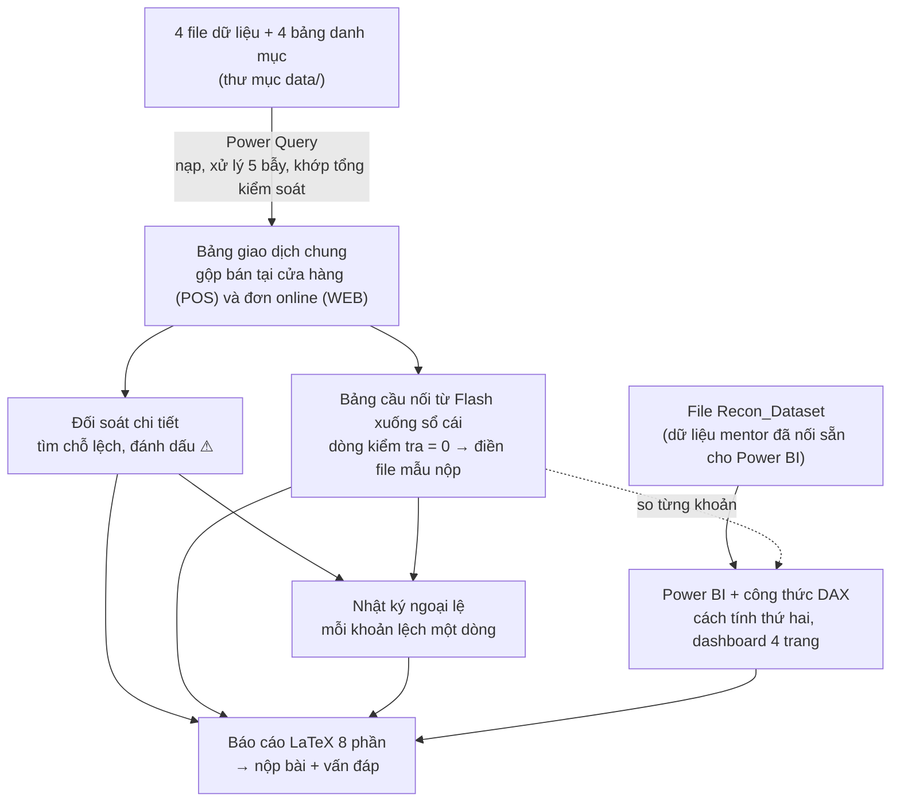

# TỪ ĐIỂN — giải thích từ khó, từ viết tắt và công cụ

> Dùng kèm [roadmap](roadmap.md) và các file trong thư mục `docs/`.

**Các từ dùng nhiều nhất**, đọc trước để không bị vướng:

| Từ | Nghĩa ngắn |
|---|---|
| **Đối soát** | So hai nguồn số cùng ghi một việc để tìm ra lệch bao nhiêu, vì sao lệch, khoản nào là lỗi |
| **Flash** | Báo cáo nhanh doanh số của phòng Kinh doanh |
| **Sổ cái** (GL – General Ledger) | Sổ kế toán ghi doanh thu chính thức của phòng Tài chính |
| **POS** (Point of Sale) / **WEB** | Hệ thống bán hàng tại cửa hàng / hệ thống đơn hàng online |
| **Bảng cầu nối** | Bảng đi từ số Flash xuống số sổ cái qua từng khoản lệch |
| **Power Query** | Công cụ có sẵn trong Excel để nạp và xử lý dữ liệu |
| **Power BI** | Phần mềm của Microsoft để làm dashboard |
| **Dashboard** | Màn hình gồm các con số chính, biểu đồ và bộ lọc |
| **DAX** (Data Analysis Expressions) | Ngôn ngữ viết công thức trong Power BI |
| **KPI** (Key Performance Indicator) | Con số chính cần theo dõi, hiện trong ô lớn trên dashboard |
| **LaTeX** | Cách soạn báo cáo bằng file chữ có lệnh định dạng rồi chuyển ra PDF |
| **Rubric** | Bảng tiêu chí chấm điểm của đề |
| **Band 1–5** | Mức điểm của mỗi phần được chấm, 5 là cao nhất |
| **Mentor** | Người hướng dẫn và chấm bài |
| **AI** (Artificial Intelligence) | Trí tuệ nhân tạo, ví dụ các công cụ trò chuyện như Claude, ChatGPT |

---

## 1. Ký hiệu và cách viết số

| Ký hiệu | Nghĩa |
|---|---|
| **Δ** (đọc là "delta") | Chênh lệch. Slide đề bài dùng ký hiệu này. Trong bài luôn tính **chênh lệch = sổ cái − Flash** |
| **\|x\|** | Giá trị tuyệt đối, tức bỏ dấu âm: \|−7.228\| = 7.228 |
| **×** | "theo" hoặc "kết hợp với". "Cửa hàng × ngày" = từng cặp (một cửa hàng, một ngày) |
| **≤, ≥** | Nhỏ hơn hoặc bằng, lớn hơn hoặc bằng |
| **→** | "Đi tới", "sau đó" |
| **⚠** | Dấu đánh dấu chỗ lệch vượt ngưỡng, phải giải thích |
| **Cách viết số** | Dấu chấm ngăn hàng nghìn, dấu phẩy là phần thập phân: 28.698.496,23 = 28 triệu 698 nghìn 496 phẩy 23 |
| **USD**, **"nghìn USD"** | Đô la Mỹ; đơn vị dùng trong bài |

---

## 2. Bức tranh tổng thể

- **Cách tính thứ nhất:** Power Query trong Excel.
- **Cách tính thứ hai:** công thức DAX trong Power BI.
- **Số chuẩn:** các con số đúng lấy từ slide đề bài, cộng bảng tính kiểm tra bằng Python.
- Ba nguồn này phải ra cùng kết quả. Đây chính là việc "tự kiểm tra lại bằng một cách tính thứ hai" mà rubric yêu cầu để đạt Band 5.

---

## 3. Đối soát và kế toán

### 3.1. Các bên và các nguồn số

| Từ | Nghĩa |
|---|---|
| **Quy ước tính** | Các quy định chung về cách tính mà nhóm chốt **trước khi nhìn số**: lấy nguồn nào làm chuẩn, công thức chênh lệch, ngưỡng phải giải thích, thứ tự các khoản trong bảng cầu nối. Xem file [quy_uoc_va_so_chuan.md](docs/quy_uoc_va_so_chuan.md) |
| **Nguồn chuẩn** | Nguồn số được coi là "đúng" để các nguồn khác so vào. Nhóm chọn sổ cái, vì đã khóa sổ, ghi theo chuẩn mực kế toán và có giấy tờ làm căn cứ |
| **Đối soát 3 mức** (đề gọi là "3 tầng") | Đi từ tổng xuống chi tiết: so theo tháng → so theo kênh → so từng cửa hàng theo ngày (và online theo ngày, loại tiền). Chỉ đào sâu vào chỗ có lệch |
| **3 bảng đối soát** | Bảng đối soát cửa hàng theo ngày, bảng đối soát online theo ngày và loại tiền, bảng đối soát hàng trả theo ngày trả và loại tiền |
| **Đối soát** | So hai nguồn số cùng ghi một việc để tìm ra lệch bao nhiêu, vì sao lệch, khoản nào là lỗi. Khác với **phân tích kinh doanh** (tăng trưởng, sản phẩm bán chạy, mùa vụ), là việc **không làm** trong bài này |
| **Phòng Kinh doanh / phòng Tài chính** | Phòng Kinh doanh lập Flash; phòng Tài chính ghi sổ cái |
| **Giám đốc Tài chính** | Người đặt 3 câu hỏi của đề và là người đọc chính của dashboard |
| **Flash** | Báo cáo nhanh của phòng Kinh doanh, gộp theo tháng × kênh × thị trường. Ghi theo **ngày đặt hàng**, **giá niêm yết**, **tính cả đơn bị hủy**, đổi ra USD theo **tỷ giá ngày**, làm tròn đến từng USD. Tổng 31.124.401 USD |
| **Sổ cái** (GL – General Ledger) | Sổ kế toán ghi doanh thu chính thức. Ghi theo **ngày ghi sổ**, **giá sau giảm giá**, bỏ đơn hủy, trừ hàng trả, đổi ra USD theo **tỷ giá cuối tháng**. Tổng 28.698.496,23 USD. Nhóm lấy sổ cái làm **nguồn chuẩn** |
| **POS** (Point of Sale) | Hệ thống bán hàng tại quầy của cửa hàng. Mỗi dòng là một món hàng trên một hóa đơn |
| **WEB** | Hệ thống quản lý đơn hàng online. Mỗi dòng là một đơn hàng |
| **Kênh bán** | Cửa hàng (POS), Online (WEB), và **chưa gắn kênh** (bút toán không thuộc kênh nào; trong file ghi là UNALLOCATED) |
| **Thị trường** | Cách Flash chia doanh số: cửa hàng chia theo 8 nước; online chia theo 5 thị trường (Australia, Canada, Eurozone, United Kingdom, United States). Eurozone là khu vực các nước dùng đồng Euro. Vì vậy khi lọc dashboard theo một nước thì phải bỏ kênh online |
| **VAS 14** (Vietnamese Accounting Standards 14) | Chuẩn mực kế toán Việt Nam số 14 về doanh thu: quy định khi nào được ghi doanh thu và ghi bao nhiêu |
| **Khóa sổ** | Chốt số của một tháng; sau khi khóa thì không sửa số tháng đó nữa |
| **Giấy tờ làm căn cứ** (kế toán gọi là chứng từ) | Hóa đơn, bảng kê, phê duyệt… chứng minh cho một bút toán |
| **Bút toán** | Một dòng ghi trong sổ kế toán |
| **Bút toán tay** | Bút toán do kế toán tự nhập, không sinh tự động từ POS hay WEB |

### 3.2. Doanh thu, các loại ngày, tỷ giá

| Từ | Nghĩa |
|---|---|
| **Giá niêm yết** (giá trước giảm giá) | Giá gốc chưa trừ giảm giá. Trong file POS, cột `line_amount` là giá trước giảm giá, dù tên cột dễ khiến tưởng là đã trừ |
| **Chiết khấu** | Phần tiền giảm giá cho khách (cột `discount_amount`) |
| **Giá sau giảm giá** | Giá trước giảm giá − chiết khấu (trong file WEB là cột `net_amount`) |
| **Đơn hủy / hàng trả** | Đơn hủy: đã đặt nhưng bị hủy, Flash vẫn tính, sổ cái không ghi. Hàng trả: đã giao rồi khách trả lại, sổ cái ghi **giảm** doanh thu vào ngày nhận hàng trả, Flash không trừ |
| **Ngày đặt / ngày bán / ngày giao / ngày trả** | Ngày khách đặt hàng online · ngày bán tại quầy · ngày giao hàng thành công · ngày nhận lại hàng khách trả |
| **Ngày ghi sổ** (cột `posting_date`) | Ngày bút toán được ghi vào sổ cái. Hàng bán vào ngày nghỉ (cuối tuần, ngày lễ) được ghi sổ vào ngày làm việc kế tiếp |
| **Ngày tính doanh thu** | Ngày mà mỗi bên dùng để tính doanh thu: Flash dùng ngày đặt/bán; sổ cái dùng ngày ghi sổ (cửa hàng) hoặc ngày giao (online) |
| **Tỷ giá** | Trong bài, tỷ giá = số đơn vị tiền nước ngoài đổi được 1 USD, nên muốn ra USD thì **chia**: USD = tiền nội tệ ÷ tỷ giá |
| **Tỷ giá ngày / tỷ giá cuối tháng** | Tỷ giá của đúng ngày giao dịch / tỷ giá của ngày cuối tháng ghi sổ. Flash dùng loại đầu, sổ cái dùng loại sau |
| **Nội tệ** | Tiền của nước có cửa hàng hoặc tiền khách trả. Bài có 5 loại tiền: AUD (đô la Úc), CAD (đô la Canada), EUR (Euro), GBP (bảng Anh), USD (đô la Mỹ) |
| **Làm tròn** | Flash làm tròn đến 1 USD mỗi dòng; sổ cái làm tròn 2 chữ số thập phân mỗi bút toán. Phần dư rất nhỏ, xếp vào nhóm "sai số chấp nhận được" |

### 3.3. Chênh lệch và ngưỡng

| Từ | Nghĩa |
|---|---|
| **Chênh lệch** | Sổ cái − Flash. Số âm nghĩa là sổ cái thấp hơn Flash |
| **% chênh lệch** | Có 2 cách chia: **÷ Flash** để hiển thị trên dashboard (đúng slide 12); **÷ \|sổ cái\|** để đánh dấu ô vượt ngưỡng (slide 28–30). Tên chỉ số luôn ghi rõ đang chia cho số nào |
| **Ngưỡng** | Mức lệch từ đó trở lên mới bắt buộc giải thích: độ lớn chênh lệch (bỏ dấu âm) lớn hơn 200 USD **và** độ lớn % chênh lệch lớn hơn 1%, tính cho một cửa hàng trong một tháng. Phải chốt **trước khi nhìn số**, để không chọn ngưỡng sao cho kết quả đẹp |
| **Ô** | Một cặp (một cửa hàng, một ngày) trong bảng đối soát. Riêng khi đánh dấu vượt ngưỡng thì xét theo cặp (một cửa hàng, một tháng) |
| **Chưa xử lý / đưa về cùng cách tính** | Chưa xử lý: so theo ngày bán, chưa bỏ dòng trùng. Đưa về cùng cách tính: cho hai bên dùng chung loại ngày, chung giá trước/sau giảm giá, chung loại tiền, chung mức chi tiết rồi mới so. Nếu chênh lệch biến mất sau khi xử lý thì đó là lệch thời điểm, không phải lỗi |
| **Lệch thời điểm** | Cùng một giao dịch nhưng hai bên ghi vào hai tháng khác nhau, ví dụ khách đặt cuối tháng 2, hàng giao tháng 3 |
| **Tự bù trừ về 0** | Phần lệch thời điểm của tháng này xuất hiện lại với dấu ngược ở tháng sau, cộng lại bằng 0. Đây là cách chứng minh một khoản chỉ là lệch thời điểm |
| **Đơn đặt năm này, giao năm sau** | Phần lệch thời điểm rơi vào ranh giới giữa hai năm, nên không tự bù trừ trong năm 2025 |
| **Điểm phần trăm** | Đơn vị đo mức thay đổi của một tỷ lệ. Từ 1,5% lên 2,0% là tăng 0,5 điểm phần trăm, không phải "tăng 33%" |

### 3.4. Năm lý do lệch, năm bẫy

| Từ | Nghĩa |
|---|---|
| **5 lý do khiến hai nguồn lệch nhau** (đề gọi là "5 trục khác biệt") | Hai nguồn đều đúng theo cách tính của mình mà vẫn lệch, vì khác nhau ở: thời điểm tính doanh thu · giá trước hay sau giảm giá · có tính đơn hủy, hàng trả không · tỷ giá ngày hay cuối tháng · mức chi tiết của một dòng. Mỗi lý do phải chứng minh bằng số, không chép phần mô tả (sheet README) của đề |
| **Mức chi tiết của một dòng** (đề gọi là "grain") | Một dòng dữ liệu đại diện cho cái gì: POS là một món hàng trên hóa đơn; WEB là một đơn; sổ cái là một bút toán gộp; Flash là một tháng × một kênh × một thị trường. Phải đưa hai bên về cùng mức chi tiết rồi mới so |
| **Cột khóa** | Cột (hoặc cặp cột) giúp phân biệt từng dòng, không dòng nào trùng. POS: cặp `receipt_no + line_no` (số hóa đơn + số thứ tự món hàng) |
| **Dòng trùng** | Hai dòng có cùng cột khóa. Trong bài: 12 dòng POS của cửa hàng 74 (mã bên kế toán NX007) ngày 29/03 bị xuất lại sáng 30/03 |
| **5 bẫy khi nạp dữ liệu** | (1) File WEB ghi ngày kiểu Mỹ MM/DD/YYYY (tháng/ngày/năm). (2) File Flash có dòng tiêu đề và dòng TỔNG CỘNG. (3) Sổ cái ghi doanh thu là số âm. (4) POS có dòng trùng. (5) Dễ cộng lẫn 5 loại tiền |
| **Vì sao sổ cái ghi doanh thu là số âm** | Theo quy ước ghi sổ của kế toán, doanh thu ghi là số âm, khoản làm giảm doanh thu (như hàng trả) ghi là số dương. Vì vậy phải đổi dấu trước khi so với Flash |

### 3.5. Bảng cầu nối và các khoản lệch

| Từ | Nghĩa |
|---|---|
| **Bảng cầu nối** | Bảng đi từ Flash xuống sổ cái qua từng khoản: Flash ± khoản 1 ± khoản 2 … = sổ cái. Làm cho 12 tháng, cho 3 bảng: toàn công ty, cửa hàng, online |
| **Khoản** | Một dòng trong bảng cầu nối, ứng với một nguyên nhân lệch, có số tiền và bằng chứng |
| **Dòng kiểm tra** | = (Flash + các khoản) − sổ cái. Phải bằng 0 (chấp nhận sai lệch ≤ 1 USD) |
| **Thứ tự các bước** | Các khoản được tính lần lượt theo thứ tự cố định. Đổi thứ tự thì số của từng dòng đổi (tổng không đổi), nên phải ghi rõ thứ tự đã dùng |
| **4 trường hợp khi ghép giao dịch** (slide 27) | Khớp · chỉ có ở POS (hoặc WEB) · chỉ có ở sổ cái · có ở cả hai nhưng lệch tiền |
| **4 nhóm chênh lệch** | **Quy tắc ghi nhận**: hai bên tính khác nhau và đều đúng; chỉ cần tính ra số tiền. **Lỗi dữ liệu**: một bên ghi sai hoặc thiếu; phải báo người giữ nguồn dữ liệu đó. **Chưa giải thích được**: dữ liệu không đủ để biết nguyên nhân; ghi lại, hỏi tiếp, không gán bừa. **Sai số chấp nhận được**: rất nhỏ, ví dụ làm tròn |
| **Ép cho khớp** | Nhét phần dư vào một khoản khác để dòng kiểm tra về 0 cho đẹp. Bị trừ điểm nặng (rubric Band 2) |
| **Lỗi chuyển dữ liệu** (đề gọi là "lỗi interface") | Doanh thu cửa hàng NX057 ngày 21/11/2025 không được chuyển sang sổ cái tháng 11, sau đó được bổ sung ngày 02/12. Cả năm bằng 0 nhưng tháng 11 âm, tháng 12 dương |
| **Phí vận chuyển** (bút toán MJ-SHIP) | 12 bút toán tay hằng tháng ghi doanh thu phí giao hàng. Có trong sổ cái, không có trong Flash. MJ = Manual Journal (bút toán tay); SHIP = Shipping (vận chuyển) |
| **Bút toán chuyển kênh** (MJ-RCL-2506) | Bút toán tay tháng 6/2025 chuyển 3.480 USD từ cửa hàng NX019 sang online, cho các đơn "đặt online, nhận tại cửa hàng". Tổng bằng 0 nhưng làm lệch số theo kênh. RCL = Reclassification (phân loại lại) |
| **ADJ-0925** (ADJ = Adjustment, điều chỉnh) | Bút toán tay 1.250 USD tháng 9/2025, không gắn kênh nào, diễn giải chung chung, không có giấy tờ chứng minh nội dung. Luôn để ở dòng "chưa giải thích được" |
| **WEB_DELIVERY / WEB_RETURN** | Hai loại bút toán trong sổ cái: doanh thu online theo ngày giao / hàng trả theo ngày trả |
| **Mã NX và mã POS** | Mỗi cửa hàng có mã bên kế toán (NX001…NX067) và mã bên POS (10, 20, …, 74…). Bảng danh mục `store_master` nối hai mã. Một cửa hàng có thể có nhiều mã POS nhưng chỉ một mã NX |

### 3.6. Nhật ký ngoại lệ, rủi ro và đề xuất

| Từ | Nghĩa |
|---|---|
| **Nhật ký ngoại lệ** | Bảng ghi mỗi khoản lệch một dòng, có các cột: mã, phát hiện ở bước nào, nguồn, mô tả, số tiền, tháng, nhóm, hướng xử lý, người phụ trách (bộ phận của công ty, ví dụ IT hay phòng Tài chính), trạng thái. Tháng sau mở ra để theo dõi tiếp |
| **Rủi ro cần theo dõi** | Dòng trong nhật ký không phải khoản lệch của năm 2025 nhưng cần theo dõi ở tháng sau |
| **Rủi ro mà đề không nhắc tới** | Rủi ro nhóm tự phát hiện (tiêu chí Band 5). Ví dụ: hàng trả sau ngày lấy dữ liệu (15/01/2026) chưa có trong dữ liệu; tháng 11 đã khóa sổ mà thiếu doanh thu; một cửa hàng có nhiều mã POS; Flash cộng cả 12 dòng POS bị trùng nên bị tính dư |
| **Đề xuất cải tiến quy trình** | Một thay đổi trong cách làm việc, có người làm, thời điểm làm và chỉ số theo dõi. Ví dụ tốt: "Trước khi khóa sổ, phòng Tài chính so số ngày có bút toán POS với số ngày có bán hàng của từng cửa hàng". Ví dụ chưa tốt: "cần thống nhất định nghĩa doanh thu" |
| **Phát hiện → Ý nghĩa → Đề xuất → Giới hạn** | Khung 4 bước viết một đề xuất (slide 41): điều dữ liệu cho thấy (có số) → điều đó nói gì về quy trình → việc cần làm → kết luận này chưa chắc ở đâu |
| **Xếp thứ tự ưu tiên** | Đề xuất nào giảm lệch, giảm rủi ro nhiều mà tốn ít công sức thì làm trước |
| **Danh sách việc kiểm trước khi khóa sổ** | Một trang liệt kê việc phòng Tài chính phải kiểm mỗi tháng: đủ ngày, không có dòng trùng, bút toán tay có giấy tờ, phần chưa giải thích dưới ngưỡng… |
| **Ai giữ nguồn dữ liệu nào** | POS và WEB do phòng Kinh doanh và bộ phận IT (công nghệ thông tin) giữ; sổ cái do phòng Tài chính; Flash do phòng Kinh doanh. Ai giữ nguồn nào thì sửa lỗi của nguồn đó |
| **Các phỏng đoán đã kiểm tra và thấy sai** | Nêu cả những phỏng đoán đã thử mà dữ liệu không ủng hộ, ví dụ "sổ cái cũng có dòng trùng?" → không. Tiêu chí Band 5 |

---

## 4. Dữ liệu và file

| Từ | Nghĩa |
|---|---|
| **4 file dữ liệu** | `POS_Sales_Export_2025.csv` (bán tại cửa hàng) · `WEB_Orders_Export.csv` (đơn online) · `Finance_GL_Revenue_FY2025.xlsx` (sổ cái; FY = Fiscal Year, năm tài chính) · `Sales_Flash_Report_2025.xlsx` (Flash). Nằm trong thư mục `data/`, **không được sửa** |
| **4 bảng danh mục** | Trong file `Nexa_Home_Master_Data.xlsx`: `store_master` (danh mục cửa hàng) · `calendar` (lịch, đánh dấu ngày làm việc) · `fx_daily` (tỷ giá ngày) · `fx_month_end` (tỷ giá cuối tháng). File này còn có sheet README (mô tả tình huống) và QC_Summary |
| **QC_Summary / tổng kiểm soát** (QC = Quality Control, kiểm soát chất lượng) | Các con số chuẩn của đề (số dòng, số hóa đơn, tổng tiền) mà dữ liệu sau khi nạp phải khớp. Khớp nghĩa là nạp không mất, không thừa dòng |
| **Sheet kiểm tra tổng** | Sheet trong file Excel của nhóm, tự so số nạp được với QC_Summary; cột chênh lệch phải bằng 0 |
| **Sheet kiểm tra chất lượng dữ liệu / phép kiểm tra** | Bảng tự đếm dòng trùng, ngày thiếu bút toán, bút toán không gắn cửa hàng… Mỗi phép kiểm tra có kết quả mong đợi, thường là 0 |
| **Recon_Dataset** (`Nexa_Home_Recon_Dataset.xlsx`) | Cùng bộ số trên, đã được mentor sắp sẵn thành các bảng nối với nhau để dùng trong Power BI |
| **Contoso V2** | Bộ dữ liệu bán hàng mẫu của Microsoft; đề dùng nó để dựng dữ liệu giả của Nexa Home. Ghi vào mục Tài liệu tham khảo của báo cáo |
| **File mẫu nộp** (`Mau_nop_Bang_cau_noi.xlsx`) | Gồm khung bảng cầu nối 12 tháng và khung nhật ký ngoại lệ. Ô nền vàng là ô nhóm điền; phải lấy số trực tiếp từ kết quả Power Query, không gõ tay |
| **Số chuẩn** (sẽ lưu ở `checks/numbers_of_record.csv`) | Bảng các con số đúng để mọi cách tính của nhóm so vào, lấy từ slide đề bài và đã tính lại để chắc chắn. Khác với "nguồn chuẩn" (là sổ cái) |
| **Bảng tính kiểm tra bằng Python** | Phép tính riêng viết bằng Python (một ngôn ngữ lập trình) để tính những con số slide không cho. Chỉ dùng trong nhóm để so, không nộp |
| **Nhãn nguồn số liệu** | Nhãn ghi sau mỗi kết luận để biết số lấy từ bảng nào, ví dụ `[BR-Tổng]` là bảng cầu nối toàn công ty. Danh sách nhãn ở file [quy_uoc_va_so_chuan.md](docs/quy_uoc_va_so_chuan.md) |
| **Các nhãn cụ thể** | `[QC]` bảng tổng kiểm soát · `[RC-CH]`, `[RC-WEB]`, `[RC-RET]` bảng đối soát cửa hàng, online, hàng trả (RC = Reconciliation, đối soát; CH = cửa hàng; RET = Return, hàng trả) · `[BR-Tổng]`, `[BR-CH]`, `[BR-WEB]` bảng cầu nối toàn công ty, cửa hàng, online (BR = Bridge, cầu nối) · `[EX-xx]` dòng số xx của nhật ký ngoại lệ (EX = Exception, ngoại lệ) |

---

## 5. Excel và Power Query

| Từ | Nghĩa |
|---|---|
| **Excel 365** | Excel bản thuê bao Microsoft 365, có sẵn Power Query (tab Data → Get Data) |
| **Sheet** | Một trang tính trong file Excel |
| **Truy vấn** (query) | Một chuỗi bước xử lý trong Power Query, cho ra một bảng. Tên đặt dạng `q_…`. Có 8 truy vấn nạp dữ liệu: `q_POS`, `q_WEB`, `q_GL`, `q_FLASH` (4 file dữ liệu) và `q_Store`, `q_Calendar`, `q_FX_Daily`, `q_FX_MonthEnd` (4 bảng danh mục) |
| **Bảng giao dịch chung** (`q_Transactions`) | Gộp POS và WEB về cùng một cấu trúc để đối soát |
| **Bản mô tả cấu trúc bảng** | Ghi tên cột, kiểu dữ liệu, dấu, cột khóa của các bảng sẽ làm, để cả nhóm làm song song mà không phải chờ nhau |
| **Bảng giả** | Bảng đúng tên cột như bản mô tả cấu trúc nhưng dữ liệu chỉ là tạm, dùng để làm trước khi bảng thật xong |
| **Bước và ghi chú** | Mỗi thao tác trong truy vấn được ghi thành một bước có tên. "Mỗi bước đặt tên rõ và có ghi chú" là tiêu chí Band 5 |
| **Ngôn ngữ M của Power Query** | Ngôn ngữ lập trình nằm phía sau các bước của Power Query. Mở Advanced Editor (cửa sổ xem và sửa code của truy vấn) để xem |
| **File `.m`** (File code của Power Query) | File chữ chứa code ngôn ngữ M của một truy vấn, lưu lên GitHub để cả nhóm đọc và kiểm tra |
| **Ô cài đặt đường dẫn thư mục** (FolderPath) | Ô chứa đường dẫn thư mục dữ liệu. Mọi truy vấn đọc file qua ô này, nên đổi máy hoặc đổi thư mục chỉ cần sửa 1 chỗ |
| **Refresh** (làm mới dữ liệu) | Chạy lại toàn bộ truy vấn từ file dữ liệu |
| **Chạy thử làm mới dữ liệu** | Bấm Refresh ở điều kiện mới: trên máy khác, và với dữ liệu giả của "một tháng mới". Chứng minh quy trình chạy lại được cho tháng sau (tiêu chí Band 5) |
| **Đọc ngày kiểu Mỹ** (vùng en-US = English – United States) | Khi đổi cột sang kiểu ngày, chọn Change Type → Using Locale → English (United States) để đọc đúng MM/DD/YYYY |
| **Full Outer Join** | Kiểu ghép hai bảng giữ mọi dòng của cả hai bên, nhờ đó thấy được dòng chỉ có ở một bên |

---

## 6. Power BI và DAX

| Từ | Nghĩa |
|---|---|
| **Power BI Desktop** | Phần mềm miễn phí của Microsoft để làm dashboard (BI = Business Intelligence). **Chỉ chạy trên Windows**; cả nhóm nên dùng cùng một phiên bản |
| **Đường nối chính / đường nối phụ** | Đường nối giữa hai bảng theo một cột chung. Mỗi cặp bảng có một đường nối chính dùng mặc định; các đường khác là đường phụ, chỉ bật khi cần (slide 19) |
| **Mark as Date Table** | Nút đánh dấu bảng ngày là bảng ngày chính thức, để công thức theo thời gian chạy đúng |
| **Công thức DAX** (trong Power BI gọi là measure) | Công thức tự tính lại theo bộ lọc đang chọn. Mỗi khoản của bảng cầu nối là một công thức riêng |
| **USERELATIONSHIP** | Hàm DAX bật một đường nối phụ trong một công thức, ví dụ tính chiết khấu online theo ngày đặt thay vì ngày giao (slide 29–30) |
| **File `dax_measures.dax`** | File chữ chứa toàn bộ công thức DAX, xuất từ Power BI để lưu lên GitHub |
| **4 trang dashboard** | Tổng quan · Cầu nối · Đối soát chi tiết · Hoàn trả, hủy và chất lượng dữ liệu. Yêu cầu chi tiết ở file [yeu_cau_dashboard.md](docs/yeu_cau_dashboard.md) |
| **Bộ lọc dùng chung / nút Đặt lại** | Ô chọn tháng, kênh, quốc gia; chọn ở một trang thì cả 4 trang đổi theo. Nút Đặt lại đưa mọi bộ lọc về mặc định |
| **Thẻ KPI** | Ô hiện một con số chính, kèm mức thay đổi so với tháng trước |
| **Biểu đồ thác nước** | Biểu đồ bắt đầu từ Flash, cộng/trừ từng khoản thành các cột lơ lửng, kết thúc ở sổ cái. Đây là hình vẽ của bảng cầu nối |
| **Câu "Điểm chính"** | Một câu tóm tắt kết luận ở đầu mỗi trang dashboard |
| **Tiêu đề biểu đồ nói kết luận kèm số** | Đúng: "Chiết khấu kéo sổ cái xuống 202,8 nghìn USD". Chưa đạt: "Biểu đồ chiết khấu theo tháng" |
